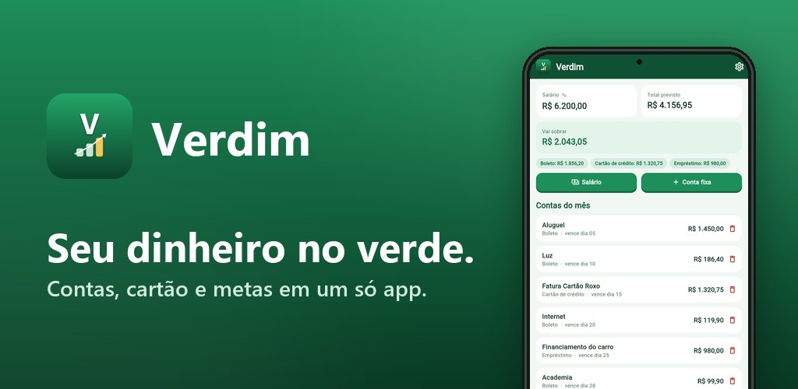
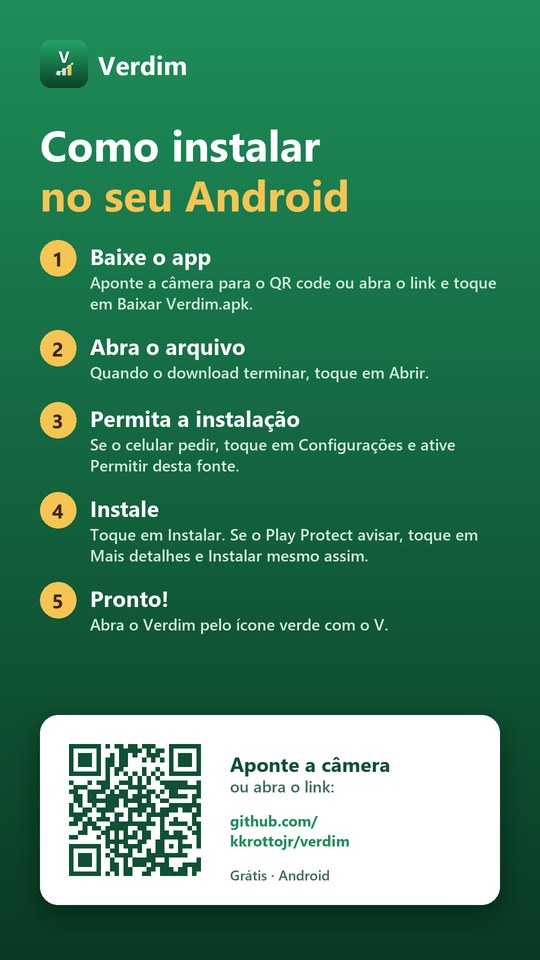
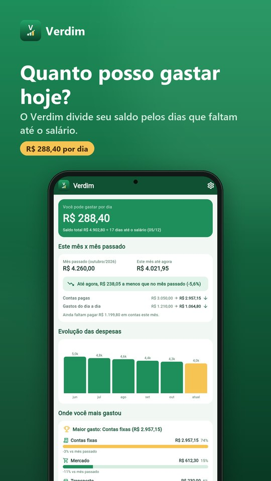
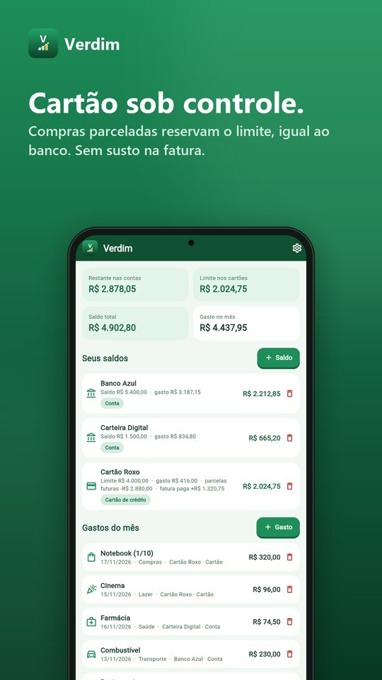

  

# Verdim

**Seu dinheiro no verde.** Contas, cartão e gastos sob controle, num app simples para Android.

## Baixar

| Versão | Para quem | Download |
|---|---|---|
| **Verdim** (recomendado) | Quase todos os celulares Android de 2017 para cá | [**Baixar Verdim.apk**](https://github.com/kkrottojr/verdim/releases/latest/download/Verdim.apk) |
| **Verdim para celular antigo** | Só se o primeiro não instalar | [Baixar Verdim_celular_antigo.apk](https://github.com/kkrottojr/verdim/releases/latest/download/Verdim_celular_antigo.apk) |

Todas as versões: [página de downloads](https://github.com/kkrottojr/verdim/releases).

## Como instalar

1. Toque no link **Baixar Verdim.apk** acima, pelo celular.
2. Quando o download terminar, toque em **Abrir** (ou abra o arquivo na pasta *Downloads*).
3. Se aparecer *"Por segurança, seu telefone não tem permissão para instalar apps desta fonte"*, toque em **Configurações**, ative **Permitir desta fonte** e volte.
4. Toque em **Instalar**.
5. Se aparecer o aviso do **Google Play Protect** ("App não reconhecido" ou "App bloqueado"), toque em **Mais detalhes** e depois em **Instalar mesmo assim**.
6. Pronto. Abra o Verdim pelo ícone verde com o "V".

> **Por que aparecem esses avisos?** O Android mostra esses alertas para qualquer app instalado fora da Play Store. O Verdim não pede acesso a contatos, fotos, localização nem internet para funcionar.

### Já tem uma versão instalada?

- **Atualizando o Verdim:** é só instalar o arquivo novo por cima. Seus dados continuam.
- **Se você instalou o antigo "JC Financeiro":** desinstale-o antes de instalar o Verdim.

## O que o Verdim faz

  
  

- **Quanto posso gastar por dia** até o próximo salário
- **Contas do mês** com lembrete no dia anterior e no vencimento
- **Cartão de crédito sob controle:** compras parceladas reservam o limite, e a fatura paga libera o limite
- **Estatísticas:** comparação com o mês passado, onde você mais gastou e limites por categoria
- **Privacidade:** seus dados ficam só no seu celular, sem cadastro e sem login
- **Backup** pelo Google Drive, WhatsApp ou e-mail, **bloqueio com digital** e **modo escuro**

## Privacidade

O Verdim guarda tudo no próprio aparelho. Nada é enviado para servidores. O backup só sai do celular quando você mesmo o compartilha.
